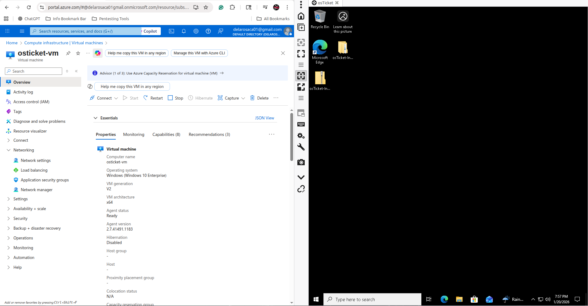

<h1>osTicket - Prerequisites and Installation</h1>

<h2>Project Overview</h2>
This project demonstrates the installation and initial setup of an enterprise-style ticketing system (osTicket) on a Windows-based environment using IIS, PHP, and MySQL. The focus is on prerequisites, dependencies, and successful deployment. 

<h2>Environments and Technologies Used</h2>

- Microsoft Azure (Virtual Machines/Compute)
- Remote Desktop
- Internet Information Services (IIS)
- PHP
- MySQL
- osTicket
- HeidiSQL

<h2>Operating Systems Used </h2>

- Windows 10 Enterprise, version 22H2 - x64 Gen2

<h2>List of Prerequisites</h2>

- IIS enabled with CGI support.
- PHP registered with IIS via PHP Manager.
- IIS URL Rewrite Module installed.
- Visual C++ Redistributable (x86) installed.
- PHP extensions enabled: (php_imap.dll, php_intl.dll, php_opcache.dll)
- MySQL server configured and accessible.

<h2>Installation Steps</h2>

1) Connect to a Windows virtual machine using Remote Desktop(In this case, I used an Azure virtual machine). Once inside the VM, <a href="https://drive.google.com/uc?export=download&id=1b3RBkXTLNGXbibeMuAynkfzdBC1NnqaD" target="_blank" rel="noopener noreferrer">
  Download osTicket Installation Files
</a>
and extract its contents to the desktop. After extracting the archive, confirm that a folder named osTicket-Installation-Files is present. This folder will be used throughout the setup process to install osTicket and its required dependencies.

 

empty

 

empty

 

empty

 

empty

 

empty

 

empty

 

empty

 

empty

 

empty

 

empty

 
